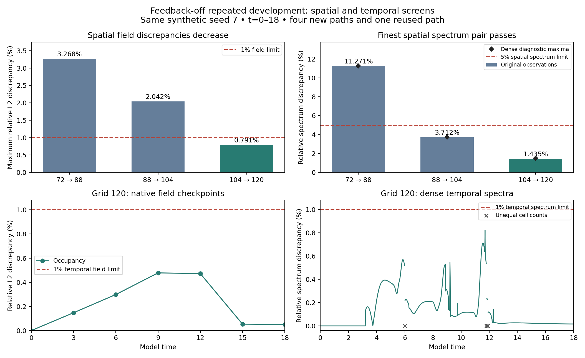

# Feedback-off developmental spatial refinement: completed assessment

**The finest spatial pair and the finest-grid timestep check pass their prospective screens.** At dt=0.00046875, comparing grids 104³ and 120³ gives maximum occupancy-field discrepancy **0.7915%** against 1%, and transport-spectrum discrepancy **1.4347%** against its separate 5% spatial limit. At grid 120³, halving dt to 0.000234375 gives maximum field discrepancy **0.4777%** and spectrum discrepancy **0.8212%**, both below their 1% temporal limits. Dense temporal spectra also pass the additional 1% screen.

The [independent saved-data review](../archive/study-reviews/2026-10-10-development-space-refinement/independent_review.json) confirms these decisions and the prescribed spatial error-decay rule. The coarser spatial comparisons remain failed. Accept this **feedback-off spatial/time screen for the tested synthetic preparation and t=0–18**, while retaining separate requirements for mechanical controls and full live-event restart replay before fresh developmental histories.

## Study and verification

The [prospective protocol](development_space_refinement.md) fixes the physical model, analytic seed-7 zygote, domain, interface width, initial target and chemistry, random streams, naturally scheduled progressive cleavage, conservative transport and evolving polarity. Mechanical feedback is disabled. Four new serial GPU paths use resident PyTorch arrays/matrices and unchanged custom CUDA mechanics/geometry kernels. The grid-72 trajectory is reused exactly through a directory link with its original report/protocol; it was not rerun or copied. This adds **zero independent scientific histories**.

Total production and automatic assessment take **91.91 minutes**, within the initial 1–2-hour estimate. New path times are 9.05 minutes at grid 88, 14.00 at 104, 20.78 at 120, and 38.81 for the grid-120 half-timestep repeat. The reused path's earlier runtime is excluded from the new production total.

The independent review imports no embryo solver or production comparison function. It reconstructs weighted chemical-distribution distances and generalized symmetric graph spectra, checks all **35 regular checkpoints and 15 live-cleavage samples**, and rebuilds all **30 spatial field comparisons**, including every required endpoint probe/order variant, and all **seven native temporal field comparisons**. It also checks all **6,154 network records and 176,605 projection records**, dense-clock coverage, conservation, graph symmetry and prescribed cutoff masks. All **30 source, 29 input and 1,684 preserved evidence hashes** verify. The runtime binary matches the preceding accepted temporal screen.

Every-step physical extrema, initial chemical prefixes, short exact restart stepping, inherited instrumentation checks and the 48 analytic calibration combinations remain recorded runtime evidence with hashes verified. Calibration computations and full-horizon restart stepping were not independently rerun during this review. The complete spatial/temporal field and spectrum comparisons were reconstructed independently. Original production summary/status remain unchanged; their provisional review flags are superseded by this separate assessment. [Review script](../archive/study-reviews/2026-10-10-development-space-refinement/review_saved_arrays.py), [review log](../archive/study-reviews/2026-10-10-development-space-refinement/review.log), [machine-readable assessment](development_space_refinement_assessment.json).

## Spatial results

All spatial comparisons use dt=0.00046875 and unchanged physical observation times. Primary density comparisons reconstruct native phases to the calibrated 112³ comparison grid at cubic order, then evaluate occupancy and chemical/polarity density. The spatial field limit is **1%** and spectrum limit **5%**.

| Native grid pair | Maximum occupancy discrepancy | Maximum spectrum discrepancy | Decision |
|---|---:|---:|---|
| 72³ → 88³ | 3.2679% | 11.2713% | Fail |
| 88³ → 104³ | 2.0421% | 3.7117% | Fail: fields |
| 104³ → 120³ | **0.7915%** | **1.4347%** | **Pass** |

The finest-pair activator/inhibitor density discrepancies are 0.7913%/0.7914%; occupancy-normalized polarity-density discrepancy is 0.07325%. Every other prescribed finest spatial limit passes: concentration-distribution distance 0.0002554, log-distribution distance 0.0002553, contrast difference 0.0001331, relative axis-ratio discrepancy 0.1065%, total-volume discrepancy 0.00905%, whole-species-amount discrepancy 0.00255%, mean-polarity difference 0.00003381 and maturity-time difference 0.0009375. There is one unmatched original observation, at t=12.15, within the preset allowance.

Occupancy/chemical field peaks occur at t=6 for 72→88 and t=9 for both finer pairs. Finest endpoint occupancy discrepancy is 0.3391–0.3398% across the four reconstruction variants. The maximum finest endpoint error spread is 6.97e-6 against 0.001. The independently reconstructed concentration/log-distribution, axis-ratio and all four field error sequences decrease under refinement, as required. This is descriptive error decay, not a formal convergence order or proof of a many-cell continuum.

Coarse spline reconstructions can overshoot the native phase bounds (minimum −0.00944 at grid 72, t=3). These diagnostic values are retained without clipping. Native saved phases remain bounded; the finest primary spatial reconstructions have only negligible negative round-off. Preserving the original diagnostic avoids accepting a failed pair through post hoc clipping or registration.

## Finest-grid timestep results

At grid 120³, compare dt=0.00046875 against 0.000234375 using **native fields** and the inherited 1% field/spectrum limits.

| Quantity | Maximum discrepancy | Limit | Decision |
|---|---:|---:|---|
| Occupancy field | **0.4777%** | 1% | Pass |
| Activator density | 0.4774% | 1% | Pass |
| Inhibitor density | 0.4774% | 1% | Pass |
| Occupancy-normalized polarity density | 0.03887% | 1% | Pass |
| Spectrum, original observations | **0.8212%** | 1% | Pass |
| Spectrum, dense observations | **0.8212%** | 1% | Pass |

All other inherited temporal gates pass, including distribution distances, chemical contrast, tissue axis ratio, whole amounts, total volume, mean polarity, cell counts and maturity timing. Last-abscission difference is 0.003046875 against 0.05. The native occupancy maximum occurs at t=9; its endpoint discrepancy is only 0.0500%, so checking the whole saved trajectory remains necessary.

The dense temporal spectrum peak occurs at t=11.7, with eight cells and sixteen versus seventeen contact edges. Three dense observations have unequal cell counts and are excluded from equal-dimensional spectral comparison; one falls on an original observation. Five equal-ID dense observations have different edge support. These are retained in the review rather than hidden through event alignment. The spectral margin is wider than in the preceding grid-72 temporal screen, but this is still a finite sampled screen.

Dense spatial spectrum maxima are 11.2713%, 3.7150% and **1.5030%**. The finest dense spatial peak occurs at t=8.775 with four cells and six edges in both paths. These additional diagnostics support the same finest-pair decision; dense spatial spectra were not a new acceptance gate. [Diagnostic figure and plotted data](figures/development-space-refinement-summary.json).

## Physical checks and interpretation

All five logical paths finish fifteen resolved divisions, reach sixteen cells and have no active furrows at t=18, with over 5.68 model units after the last division. Maximum recorded cell-volume error is **1.6176%** against 5%; the minimum equivalent radius is 5.0989 grid spacings across all paths and 8.4995 on grid 120. Mechanical clipping is zero. Positive finite chemistry, nondividing connectivity, resolved daughter connectivity and the original event/dilution conservation checks pass. Maximum saved boundary occupancy is **6.37e-12** against 0.01. Independently reconstructed operators conserve constants and volume-weighted amounts and retain weighted symmetry.

Each path records eight bitwise exact restored/uninterrupted steps at all three live-cleavage windows and an independent eight-step chemical/dilution prefix with zero reported log discrepancy. The saved restart states and their numerical corrections are independently inspected. Full-horizon restart replay remains a separate requirement.

At grid 120, halving dt approximately halves maximum pre-projection volume error (0.0007571 → 0.0003788) and correction magnitude (0.00026853 → 0.00013430). Post-projection residual stays near 1e-7. These are effective-phase projection diagnostics, distinct from visible-phase cell-volume error. They do not isolate a causal source of integration sensitivity.

This result clears the previously unresolved feedback-off spatial screen at the tested finer resolution. The failed 72→88 and 88→104 comparisons and historical studies remain unaccepted. Qualification of the other mechanical branches, biological differentiation, and infinite-time or many-cell limits remain separate questions. This short qualification horizon retains weak chemical contrast (final activator log standard deviation about 0.0043); it is not a pattern-formation or identity assay.

## Next step

Qualify the three remaining matched mechanical branches—activity-dependent tension/adhesion, polarity-dependent tension, and their full combination—at the finer spatial/timestep settings, retaining their own temporal/spatial gates. Include full live-cleavage restart replays for the configurations selected for science. After those checks pass, launch the independently initialized fresh-zygote pilot with matched controls and a prespecified post-cleavage scientific observation window. No further simulations were launched during this review.

[Launch/completion record](development_space_refinement_launch.md), [original production summary](../output/studies/development-space-refinement/summary.json), [reporting snapshot](../archive/study-document-snapshots/2026-10-10-before-completed-development-space-review/manifest.json), [preceding temporal assessment](development_time_diagnosis_assessment.md).
