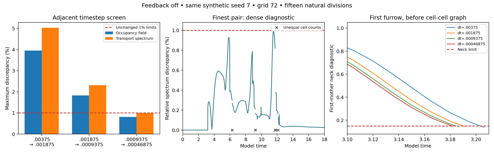

# Feedback-off developmental timestep diagnosis: completed assessment

**The finest adjacent timestep pair passes the unchanged temporal screen. Full repeated development remains unqualified.** At grid 72, comparing dt=0.0009375 with 0.00046875 gives maximum occupancy-field discrepancy **0.8097%** and transport-spectrum discrepancy **0.9886%**, both below their 1% limits. A separate reconstruction from the saved arrays and logs confirms every original temporal decision. The two older pairs remain failed.

The denser 0.015-unit network observations give a finest-pair spectrum maximum of **0.9916%**, also below 1%, but with little headroom. This is a useful temporal result for one feedback-off synthetic trajectory. It does not qualify spatial accuracy, the other mechanical controls, a full fine-timestep CPU reference, full restart behavior or fresh independent histories.

## Design and independent review

The [prospective protocol](development_time_diagnosis.md) follows the same analytic seed-7 zygote to t=18 and sixteen cells using naturally scheduled progressive cleavage, conservative transport, evolving chemistry and polarity, and disabled mechanical feedback. All model parameters, custom CUDA kernels, pressure correction, stochastic rules and limits are unchanged. Four serial GPU paths use timesteps 0.00375, 0.001875, 0.0009375 and 0.00046875. Total production/assessment runtime is **11.71 minutes**; the finest individual path takes **5.52 minutes**.

The first two paths reproduce the preserved original histories, events, lineages and every array in all seven regular checkpoints exactly. This supports full-path noninterference of the added diagnostics for those paths. The finer two are new numerical trajectories of the same synthetic preparation. The study adds **zero independent scientific histories**.

The [independent review](../archive/study-reviews/2026-10-10-development-time-diagnosis/independent_review.json) uses NumPy/SciPy and the preceding independent review's reconstruction functions, with no embryo solver or production-comparison imports. It recomputes weighted chemical-distribution distances, conservative graph spectra through a generalized symmetric eigenproblem, and all 21 adjacent-pair native field comparisons. It inspects all 28 regular checkpoints and 12 live-cleavage restart samples, all 4,914 network records and all 55,145 pressure-projection records. All 27 source, 38 input and **1,592 preserved evidence** hashes verify; 1,674 consumed files are hashed in the review.

Every-step physical extrema, short exact restarts, the chemical prefix checks and the instrumentation gate remain recorded runtime evidence. Saved-array inspection is independent, but a new full-horizon restart replay was not performed. The original production summary/status retain their original provisional flags; the separate assessment records the completed review without rewriting original evidence. [Review script](../archive/study-reviews/2026-10-10-development-time-diagnosis/review_saved_arrays.py), [review log](../archive/study-reviews/2026-10-10-development-time-diagnosis/review.log), [machine-readable assessment](development_time_diagnosis_assessment.json).

## Temporal results

Comparisons use the same physical times, without aligning division events or registering shapes. Occupancy and chemical fields are compared at seven native-grid checkpoints. Spectra and aggregate measurements use 121 original observations.

| Adjacent timesteps | Maximum occupancy discrepancy | Maximum spectrum discrepancy | Original screen |
|---|---:|---:|---|
| 0.00375 → 0.001875 | 3.9510% | 5.0340% | Fail |
| 0.001875 → 0.0009375 | 1.8234% | 2.3152% | Fail |
| 0.0009375 → 0.00046875 | **0.8097%** | **0.9886%** | **Pass** |

Activator/inhibitor density errors decrease similarly, reaching 0.8092%/0.8092%. Finest-pair polarity-density discrepancy is 0.0625%, normalized by occupancy. Every other inherited finest-pair limit passes: concentration-distribution distance 0.0001344, log-concentration distribution distance 0.0001337, contrast difference 0.0000993, axis-ratio discrepancy 0.1756%, total-volume discrepancy 0.0119%, whole-species-amount discrepancy 0.00255%, and mean-polarity difference 0.00000705. Last-abscission difference is 0.00515625 against 0.05. Original observation cell counts match throughout the finest pair.

All adjacent error sequences decrease under halving. This is descriptive error decay, not a formal convergence order or continuum limit. The finest occupancy peak occurs at t=9 and the original spectrum peak at t=11.55. Final occupancy discrepancy is only 0.0882%; endpoint agreement alone would understate developmental sensitivity.

All four paths finish fifteen resolved events with no active furrows. Recorded maximum cell-volume error is at most **1.6176%** against 5%; minimum equivalent radius is **5.0989 grid spacings** against four. Mechanical clipping is zero. Daughter connectivity, event amount/target conservation and occupancy/volume continuity pass their preset gates. Maximum saved boundary occupancy is 6.51e-12. Independently reconstructed transport preserves constants and volume-weighted amounts and has weighted symmetry. Each path records eight exact restored/uninterrupted steps at each of three live-cleavage windows and an independent eight-step chemical prefix with zero reported log discrepancy.

## What the new diagnostics establish

**Differences precede the first cell–cell graph.** At t=3, every path still has one dividing mother and zero contact edges. Finest-pair occupancy discrepancy is already 0.2853%. The two finest paths start that furrow at the identical time, 2.143125, and their initial spindle axes agree to floating-point precision. Their first abscissions occur at 3.1846875 and 3.181875. This rules out contact-cutoff changes, daughter partition noise or a materially changed first spindle axis as the sole origin of the discrepancy. It does not separate ordinary mechanics from furrow integration or volume projection.

**Volume corrections shrink with timestep.** The independently parsed per-call maxima are:

| Timestep | Projection calls | Maximum absolute correction | Maximum pre-projection relative volume error | Maximum post-projection relative volume error |
|---|---:|---:|---:|---:|
| 0.00375 | 3,690 | 0.00214260 | 0.00594620 | 9.99e-8 |
| 0.001875 | 7,360 | 0.00107357 | 0.00298916 | 9.99e-8 |
| 0.0009375 | 14,703 | 0.00053726 | 0.00149838 | 1.00e-7 |
| 0.00046875 | 29,392 | 0.00026875 | 0.00075004 | 9.98e-8 |

These volumes use the effective phase including carry and each mother's projection capacity; they differ from the visible-phase cell-volume audit. Pre-projection error and correction magnitude approximately halve, while post-projection residual remains near the routine's fixed tolerance. Temporal errors continue to decrease rather than visibly stall at that tolerance. This is consistent with integration sensitivity during furrow deformation; it does **not** establish that projection causes the trajectory differences. No isolated projection intervention was performed.

**Later event clocks and weighted contacts also differ.** Maximum corresponding-parent abscission discrepancy decreases from 0.028125 to 0.015 and then 0.005625. Maximum spindle-axis difference decreases from 0.0911° to 0.0506° and then 0.0237°. Parent trees and partition draws match across all adjacent pairs.

The dense spectrum maxima decrease from 5.0708% to 2.4645% and then **0.9916%**. The finest peak occurs at t=11.535 with eight cells and sixteen edges in both paths. Different edge weights therefore matter even when edge counts agree. Maximum homologous conductance-matrix discrepancy is **1.0900%**; it is a diagnostic, not a separately prescribed 1% acceptance gate.

The finest pair has six unequal-cell-count dense observations, omitted from equal-dimensional spectrum comparisons, and two equal-ID observations with different edge support, at t=9.96 and 12.27. The original coarser observation counts match. The dense result does not establish agreement through every abscission instant. Its spectral margin is only **0.00845 percentage points** below 1%, or about 0.845% of the limit. These details should remain visible in further qualification. [Per-parent clocks and first-furrow data](../archive/study-reviews/2026-10-10-development-time-diagnosis/cleavage_diagnosis.json).

## Decision and next test

Accept the **feedback-off adjacent temporal screen at grid 72 through t=18**. Retain the original failed pairs and the [previous failed repeated-development study](repeated_development_gpu_assessment.md). There is no new cell-identity or initiation result.

Next repeat feedback-off spatial refinement using dt=0.00046875, preserving the physical model, matched analytic initial state, event rules and existing limits. Verify temporal accuracy at the selected finer grid rather than assuming the grid-72 pass transfers. Retain dense spectrum/event diagnostics; the narrow margin and conductance discrepancies remain relevant. Then qualify the feedback/polarity controls and full live-event restart replay. Fresh independently seeded zygote histories follow those checks. No further job was launched as part of this review.

[Launch/completion record](development_time_diagnosis_launch.md), [original production summary](../output/studies/development-time-diagnosis/summary.json), [reporting snapshot](../archive/study-document-snapshots/2026-10-10-before-completed-development-time-review/manifest.json).
