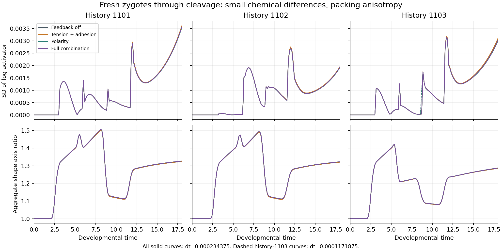

# Finer matched developmental controls: completed assessment

The independent saved-array audit **accepts all three new history-1103 control pairs** under the unchanged gates. Together with its previously accepted feedback-off refinement and the retained passing pairs for histories 1101/1102, **all twelve history–branch preparations now have scoped numerical support through t=18**. This combines separately declared timestep ladders; the original failed pilot remains failed and is not retrospectively accepted.

[Frozen design](fresh_zygote_control_completion.md), [machine-readable assessment](fresh_zygote_control_completion_assessment.json), [independent saved-array audit](../archive/study-reviews/2026-10-12-fresh-zygote-controls/independent_review.json), [audit log](../archive/study-reviews/2026-10-12-fresh-zygote-controls/review.log). Current protocol SHA-256: `44af9b2bfdd77176891e015e5024db2aeca6acca413f7d8dd63e5b8a86ffd926`. Original coordinator records, including their provisional/pending-review fields, are unchanged; this separate assessment records the independent decision.

## Completion and unchanged limits

The six new paths completed **12 October 2026 at 04:43 America/New_York**, after **5.66 hours** (about 5 hours 40 minutes). Every path reaches t=18 with sixteen cells, fifteen completed abscissions, no active furrows and at least three mature units. The new study adds **zero independent histories**: its six paths and two reused feedback-off references are nested within existing history 1103.

All history-1103 pairs compare **dt=0.000234375 versus 0.0001171875** at grid 120³. Density fields and both spectral checks retain their **1%** limits. The accepted feedback-off pair below is reused; only the other three pairs are new.

| Branch | Maximum density-field error | Maximum regular-spectrum error | Maximum dense-spectrum error | Decision |
| --- | ---: | ---: | ---: | --- |
| Feedback off | 0.1007% | 0.3400% | 0.4936% | Pass |
| Tension + adhesion | 0.0931% | 0.3163% | 0.5368% | Pass |
| Polarity | 0.1093% | 0.3399% | 0.3415% | Pass |
| Full combination | 0.1010% | 0.2866% | 0.2875% | Pass |

All chemical distribution, contrast, shape, volume/amount, polarity, maturity-time, physical, boundary/connectivity, conservative graph and cleavage gates pass. Every actual-start prefix and recorded eight-step live-cleavage restart passes. Contact-support switches and unequal-count observations remain visible: a pass does not eliminate the hard contact cutoff or prove a convergence order. The tension/adhesion dense maximum is at t=11.43 with sixteen versus seventeen edges; it remains below the same 1% limit.

## Independent audit and combined preparation scope

The NumPy/SciPy audit calls no production comparison or embryo solver and performs no fresh GPU stepping. It verifies **48 source hashes and 435 input hashes**, all eight history-1103 paths' saved history/graph/pressure/event evidence, **56 regular checkpoint states and density reconstructions**, and **24 live-cleavage checkpoint states**. It independently recomputes every history-1103 distribution/shape/volume/amount/polarity comparison and regular/dense graph spectrum.

The earlier review of histories 1101/1102 had recomputed their history and graph comparisons but retained recorded passing density-field errors. This audit additionally rebuilds **all 112 checkpoint states/density fields** for those eight pairs and recomputes their regular/dense comparisons; they pass without changing any gate. Thus the combined statement does not assume independently checked density fields where they were previously only recorded. Earlier pressure/event checks are inherited through their immutable independently reviewed evidence, not replayed mechanically.

There are **three registered fresh histories (1101, 1102, 1103)**, each with four mechanical branches. They share a primary saved endpoint timestep **0.000234375**. Histories 1101/1102 compare 0.00046875/0.000234375; history 1103 compares 0.000234375/0.0001171875 under the separately registered refinement. Report these different ladders explicitly. All twelve preparations pass their scoped timestep screens; three histories remain a pilot, not a population-frequency estimate or universal developmental convergence result.

The original history-1103 coarse comparison still fails at 1.1836%. The original failed status, protocol and six unexecuted control cases remain unchanged. The new runs belong to this separate finer design. Recorded actual-start and short restart tests are verified from saved evidence; no new full fine CPU ladder or full remaining-horizon mechanics replay is claimed.

## What the development shows

The following table uses the **common primary endpoint timestep 0.000234375** rather than mixing finest endpoints across histories.

| History | Branch | SD of log activator at t=18 | Aggregate axis ratio | Frozen uniform unstable modes |
| --- | --- | ---: | ---: | ---: |
| 1101 | Feedback off | 0.00358851 | 1.32445603 | 9 |
| 1101 | Tension + adhesion | 0.00361102 | 1.32441930 | 9 |
| 1101 | Polarity | 0.00354146 | 1.32702773 | 8 |
| 1101 | Full combination | 0.00356414 | 1.32700118 | 8 |
| 1102 | Feedback off | 0.00194193 | 1.32064567 | 9 |
| 1102 | Tension + adhesion | 0.00195607 | 1.32061269 | 9 |
| 1102 | Polarity | 0.00192271 | 1.32291579 | 8 |
| 1102 | Full combination | 0.00193641 | 1.32290925 | 8 |
| 1103 | Feedback off | 0.00309181 | 1.28524863 | 9 |
| 1103 | Tension + adhesion | 0.00311128 | 1.28512464 | 9 |
| 1103 | Polarity | 0.00300625 | 1.28754903 | 9 |
| 1103 | Full combination | 0.00302454 | 1.28745161 | 9 |

**Small chemical differences arise during cleavage, but sustained differentiation has not yet been demonstrated.** Endpoint log-activator SD spans **0.00192–0.00361** across the twelve preparations. Chemistry remains close to uniform. These differences and branch effects are continuous descriptive measurements, not two prescribed identities, autonomous memory, lineage commitment or biological cell types. The short mature window here is insufficient to establish persistent organization.

**Packing and cleavage produce shape anisotropy in every branch, including feedback off.** Polarity changes the endpoint shape only slightly in these runs. This is not evidence for a large chemically selected axis or activator–inhibitor-specific shape organization. The figure shows recorded trajectories rather than independent biological replicas or a parameter sweep.

**The frozen endpoint chemistry still has supported growing modes:** 8–9 nonuniform modes across these preparations. This calculation holds contact conductances and volumes fixed and linearizes about uniform chemistry. It does not establish that fluctuations will grow during continued moving mechanics, or predict whole-system stability. The longer moving experiment is still needed to test whether contact remodeling changes formation versus maintenance in fresh histories.

## Next test

Register the **mature-timestep qualification on the actual twelve saved primary endpoints**, retaining each history's matched mechanical context. Test efficient mature candidates 0.00375 and 0.001875, with 0.0009375 only if required under a separately declared failure/diagnostic rule. Keep chemistry, geometry, polarity, lineage/event and random state, phase carry and chemical correction; do not reset chemistry or supply a pattern. Require actual-start CPU/GPU prefixes, correction-aware restarts, physical checks and matched timestep comparisons in the mature context.

After independent acceptance of that mature numerical method, begin the planned **60-elapsed-unit formation window**, with the **240-unit continuation** separately gated. Measure first sustained formation, retention/loss and contact-network evolution by history. These developmental qualification runs alone cannot decide initiation-versus-maintenance or biological identity.

No new simulation is launched by this review. Ledger and manuscript scientific snapshots remain unchanged. The README's numerical scope and lab notebook are updated separately, while all original failures remain accessible.
