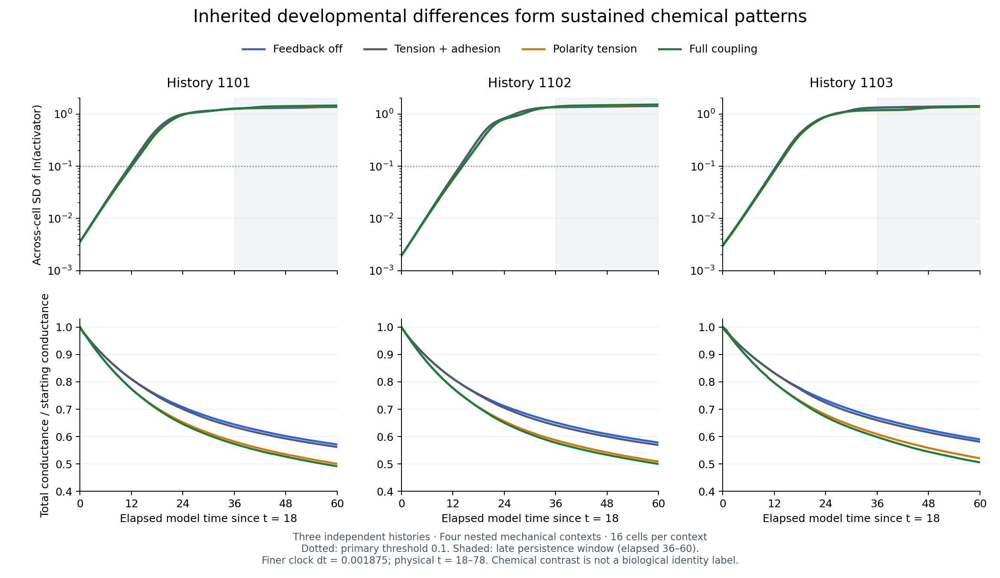

# Inherited fresh-history formation: completed assessment

The independent saved-array audit **accepts all twelve registered full-horizon timestep comparisons**. In **all three independent histories (1101–1103)**, inherited developmental chemistry forms sustained cell-to-cell differences under every tested mechanical context, including feedback off. The primary threshold 0.1 and both sensitivity thresholds 0.05/0.2 give sustained and late-persistent outcomes at both clocks.

[Registered design](fresh_zygote_formation.md), [assessment data](fresh_zygote_formation_assessment.json), [independent saved-array review](../archive/study-reviews/2026-10-13-fresh-zygote-formation/independent_review.json), [audit scope](../archive/study-reviews/2026-10-13-fresh-zygote-formation/scope.md), [audit log](../archive/study-reviews/2026-10-13-fresh-zygote-formation/review.log). Protocol SHA-256: `e193c41f6d018cf4cfc7ed88777e00f7e62e99aa89fb98e783baab0c8e199d06`. Original production status/summary remain provisional records; scoped acceptance is recorded separately here. Original failures, sources, thresholds, manuscript and results-ledger snapshots remain unchanged.

## What was tested

Continue the twelve actual developmental preparations from physical **t=18 to 78**, without a chemistry reset, supplied pattern, feedback switch, further division or backend handoff. The t=18 chemistry already contains small inherited daughter fluctuations; it is not exactly uniform. Use dt=0.00375 and 0.001875 at grid 120³ and extent 2.24. These 24 numerical paths and twelve comparisons are nested within **three existing independent histories**, not 24 independent replicates. Each branch retains its own geometry, polarity and chemistry shaped during earlier development.

The mature continuation uses unchanged compensated resident mechanics: PyTorch arrays/matrices and custom CUDA mechanics/geometry/polarity, float32 visible phase with float64 residual carry and float64 compensated chemical integration. Qualified earlier cleavage preparations and this continuation use their separately tested clocks; this is not one uniform-timestep run from fertilization to t=78.

## Formation and mechanical context

Contrast is across-cell SD of **natural-log activator concentration**, a dimensionless chemical-state measurement. Primary onset is the beginning of a fully observed 24-unit interval above 0.1, measured as elapsed time since t=18. Late persistence requires every saved observation during elapsed 36–60 to exceed threshold. Both clocks agree on onset at 0.15-unit observation resolution; all sampled losses/recoveries are reported, and none occurs at the three thresholds in this cohort.

Use finer-clock values for the descriptive table:

| History | Context | Sustained onset, elapsed | Final contrast | Late minimum | Conductance decrease | Endpoint growing modes |
| --- | --- | ---: | ---: | ---: | ---: | ---: |
| 1101 | Feedback off | 11.70 | 1.4084 | 1.2589 | 42.88% | 5 |
| 1101 | Tension + adhesion | 11.70 | 1.3615 | 1.2733 | 43.80% | 5 |
| 1101 | Polarity tension | 12.15 | 1.4364 | 1.2470 | 49.94% | 5 |
| 1101 | Full coupling | 12.15 | 1.4548 | 1.2586 | 50.85% | 4 |
| 1102 | Feedback off | 13.80 | 1.4188 | 1.3392 | 42.18% | 5 |
| 1102 | Tension + adhesion | 13.65 | 1.4364 | 1.3538 | 43.09% | 5 |
| 1102 | Polarity tension | 14.40 | 1.5014 | 1.3729 | 49.11% | 5 |
| 1102 | Full coupling | 14.25 | 1.5192 | 1.3863 | 50.01% | 5 |
| 1103 | Feedback off | 12.60 | 1.4032 | 1.3145 | 41.03% | 6 |
| 1103 | Tension + adhesion | 12.45 | 1.4219 | 1.3301 | 41.90% | 6 |
| 1103 | Polarity tension | 12.90 | 1.3605 | 1.1752 | 47.95% | 5 |
| 1103 | Full coupling | 12.75 | 1.3762 | 1.1868 | 49.43% | 4 |

The smallest late-window contrast is **1.1752**, above even the 0.2 sensitivity threshold. Small inherited differences therefore grow into sustained nonlinear chemical heterogeneity in all twelve contexts. This supports formation along these qualified developmental histories without fixed A/B labels. It does not by itself establish biological cell identities or their functions.

**Polarity tension is not necessary for chemical formation in these preparations.** Feedback-off branches form in 3/3 histories. Polarity-only versus feedback off delays primary onset by 0.45, 0.60 and 0.30 model units; adding polarity to tension/adhesion gives the same three delays. Full coupling versus feedback off delays onset by 0.45, 0.45 and 0.15. These are modest context differences, not universal initiation suppression.

The effect on final contrast has **no consistent sign**: polarity-associated branches have greater contrast than feedback off in histories 1101/1102, but lower contrast in 1103. Every branch still passes sustained formation and late persistence. Do not report polarity as universally amplifying or suppressing differentiation. Baseline polarity evolution remains enabled even when its mechanical tension coupling is zero; this is not a complete polarity-removal experiment.

## Communication remodels without closing the formation window

Total undirected conductance decreases **41.03–50.85%**, including substantial loss under feedback off, which retains passive mechanics. Polarity-associated branches lose more conductance in all three histories. Each endpoint nevertheless retains **4–6 growing nonzero chemical modes**, with positive frozen uniform-state maximum growth. The observed remodeling has not removed all supported instability modes over this window.

For these parameters, the frozen uniform chemical instability band is approximately **4.325<λ<42.039**. Its boundaries are the roots of D_a D_b λ²+(βD_a−D_b)λ+β=0. Every finer-clock regular snapshot retains at least4 growing modes; the smallest snapshot maximum growth is0.0955. Network remodeling moves eigenvalues, but does not close the supported-mode window in the sampled formation trajectories. These are snapshot measurements, not guarantees between observations.

This qualifies the earlier mechanistic narrative. Moving mechanics can suppress initiation in the older mature-reset preparations, and conductance preservation restored formation there. **The present inherited developmental preparations all form patterns while contacts remodel.** Network remodeling is consequential, but its amount alone does not determine failure; the supported spectrum, state, preparation and timing matter. The cohorts and preparations differ, so this comparison does not isolate the older chemistry reset as the cause of suppression or invalidate those scoped mature results.

Frozen growth rates linearize uniform chemistry while holding current geometry fixed; they do not prove whole-system stability, causal mediation or endpoint bistability. Tissue axis ratios remain approximately1.40–1.42 in all contexts; the largest full-versus-off endpoint difference is only0.0093. An activator–inhibitor-specific tissue axis or large-scale shape organization is not established.

## Numerical acceptance

All 24 paths,24 actual-start prefixes and twelve complete timestep comparisons pass unchanged gates. Largest independently reconstructed differences:

- Native occupancy/chemical/polarity density fields: **0.018906%**, against 1%.
- Dense graph spectrum: **0.100184%**, against 1%.
- Homologous chemical log concentration: **0.00485283**, against 0.01.
- Homologous transport-matrix norm: **0.245648%**, against 1%.

| History | Context | Maximum native-field error | Maximum dense-spectrum error | Maximum cellwise log error | Decision |
| --- | --- | ---: | ---: | ---: | --- |
| 1101 | Feedback off | 0.001561% | 0.093779% | 0.000418893 | Pass |
| 1101 | Tension + adhesion | 0.000813% | 0.001126% | 6.79331e-05 | Pass |
| 1101 | Polarity tension | 0.001420% | 0.000819% | 0.000206752 | Pass |
| 1101 | Full coupling | 0.001401% | 0.001018% | 0.000214413 | Pass |
| 1102 | Feedback off | 0.001160% | 0.000886% | 8.83356e-05 | Pass |
| 1102 | Tension + adhesion | 0.001198% | 0.001155% | 9.1389e-05 | Pass |
| 1102 | Polarity tension | 0.001423% | 0.092527% | 0.000178272 | Pass |
| 1102 | Full coupling | 0.001477% | 0.001029% | 0.000180175 | Pass |
| 1103 | Feedback off | 0.002184% | 0.094767% | 0.000409801 | Pass |
| 1103 | Tension + adhesion | 0.002262% | 0.000996% | 0.000413299 | Pass |
| 1103 | Polarity tension | 0.018906% | 0.100184% | 0.00485283 | Pass |
| 1103 | Full coupling | 0.017544% | 0.000964% | 0.00401941 | Pass |

Five isolated sampled contact-support mismatches are retained: history1101 feedback-off at t=40.35; history1102 polarity at43.515; history1103 feedback-off at36.54; history1103 polarity at28.47 and75.78. The largest field and chemical discrepancies occur in history1103 polarity and remain within the registered gates. Hard-cutoff discontinuities remain visible; matched classifications do not imply identical contact topology or exact trajectories.

Recorded every-step extrema pass: maximum volume error **1.2399%** against 5%, minimum equivalent radius **8.5095 voxels** against 4, zero clipping and dilution amount error **4.44e-16** against 2e−14. All paths retain sixteen cells, fifteen inherited abscissions and no active furrows, with passing observed boundary/connectivity checks and exact eight-step compensation-aware replay at elapsed 12 and 36.

## Independent audit and limits

The NumPy/SciPy audit imports no embryo solver or production comparison routine and verifies **63 source pins and 523 input pins**, the accepted parent review, runtime binary and every saved result/prefix archive. It reconstructs **9,624 regular observations**, **96,024 dense conservative graphs**, all distribution/homologous comparisons and chemical growth rates, and **144 complete checkpoint states/native fields**. Generalized eigenproblems check conservation, weighted self-adjointness, operator sign and recorded spectra. Chemical outcomes are recalculated from concentrations rather than copied from the formation labels.

All 432 nonmetadata arrays in 24 retimed starts match the accepted source arrays byte for byte, and every initial full checkpoint exactly matches its retimed start. Only the declared Config step horizon changes. Targets, IDs/parents, cycle due times, lineage/events and random states remain unchanged through every saved checkpoint. Each restart-start archive is byte-identical to its corresponding full checkpoint.

CPU/GPU prefixes, every-step extrema and exact eight-step restarts are verified from immutable saved evidence, **not independently rerun trajectories**. Sampled volumes, radii, cell connectedness, boundary occupancy and numerical carry/correction are independently reconstructed. Acceptance is a two-clock comparison at one spatial resolution in these histories for 60 elapsed units; it does not establish asymptotic convergence order, a full fine CPU horizon, continuum transport accuracy or universal developmental behavior. Original scheduling and developmental failures remain failed.

## Decision and next priority

Accept dt=0.00375/0.001875 as the **scoped 60-unit formation comparison** in these twelve inherited contexts. No additional formation rerun or automatic timestep fallback is required by the registered criteria.

Next, separately register the **240-total-elapsed-unit maintenance test from t=18**, retaining the existing formation states and each branch's inherited chemistry/mechanics, with its own full-window timestep and physical gates. This means continuing the elapsed60 endpoints by 180 units to physical t=258, not adding 240 units. Formation does not qualify that longer clock window. Endpoint coexistence and perturbation/context response tests must follow before these differences are interpreted as candidate identities, commitment or memory.

The coordinator finished **12 October 2026 at 21:34:45 America/New_York**, in **10.080 hours** (about 10 hours 5 minutes), consistent with the updated forecast. The audit took **14.1minutes**. The scientific GPU is idle; this review launches no new simulation. README scope and the lab notebook are updated separately; manuscript and ledger remain unchanged.
