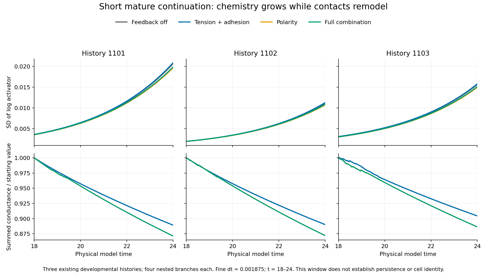

# Mature-timestep qualification: completed assessment

The independent saved-array audit **accepts all twelve registered timestep comparisons**. The actual developmental endpoints of histories 1101–1103 can be continued from physical t=18 to24 at **dt=0.00375 versus 0.001875**, at grid120 and extent2.24, under all four tested mechanical contexts. This qualifies the short mature clock comparison; long-window accuracy and persistent organization remain untested.

[Registered design](fresh_zygote_mature_qualification.md), [scheduler correction](fresh_zygote_mature_clock_fix.md), [assessment data](fresh_zygote_mature_clock_fix_assessment.json), [independent saved-array review](../archive/study-reviews/2026-10-12-fresh-zygote-mature/independent_review.json), [audit scope](../archive/study-reviews/2026-10-12-fresh-zygote-mature/scope.md), [audit log](../archive/study-reviews/2026-10-12-fresh-zygote-mature/review.log). Protocol SHA-256: `057f18713e37c562cc70743dd0dbff37be6e76b53040455a4535452752c19b04`. Original production status/summary, sources, thresholds and previous failures remain unchanged. Acceptance is recorded here separately from the coordinator's provisional fields.

## Numerical result

All **24 paths**, **24 actual-start prefixes** and **12 paired comparisons** pass. Twenty-three prefixes are newly executed; the identical, already passing first prefix is reused with explicit provenance from the retained scheduling failure. These paths are nested within **three existing independent histories**, each with four mechanical branches and two timesteps; there are zero new histories. Actual chemistry, geometry, polarity, numerical carry/correction, lineage and random states are inherited without a chemical reset, supplied pattern or mechanical switch.

The largest independently reconstructed differences are:

- Native occupancy/chemical/polarity density fields: **0.000738%**, against the unchanged 1% gate.
- Dense graph spectrum: **0.000981%**, against the unchanged 1% gate.
- Homologous transport-matrix relative norm: **0.001347%**, against 1%.
- Homologous chemical log concentration: **1.04978e-06**, against 0.01.

| History | Branch | Maximum density-field error | Maximum dense-spectrum error | Decision |
| --- | --- | ---: | ---: | --- |
| 1101 | Feedback off | 0.000725% | 0.000873% | Pass |
| 1101 | Tension + adhesion | 0.000725% | 0.000873% | Pass |
| 1101 | Polarity | 0.000647% | 0.000784% | Pass |
| 1101 | Full combination | 0.000647% | 0.000783% | Pass |
| 1102 | Feedback off | 0.000733% | 0.000886% | Pass |
| 1102 | Tension + adhesion | 0.000733% | 0.000889% | Pass |
| 1102 | Polarity | 0.000654% | 0.000792% | Pass |
| 1102 | Full combination | 0.000654% | 0.000788% | Pass |
| 1103 | Feedback off | 0.000738% | 0.000981% | Pass |
| 1103 | Tension + adhesion | 0.000737% | 0.000980% | Pass |
| 1103 | Polarity | 0.000635% | 0.000829% | Pass |
| 1103 | Full combination | 0.000635% | 0.000827% | Pass |

No between-timestep contact-support mismatch occurs at the 401 dense observations in each path. Contacts still change **within** trajectories; matched support between clocks does not mean a frozen graph or remove the hard cutoff.

The recorded every-step extrema satisfy all physical limits: maximum volume error **1.1607%** (<5%), minimum equivalent radius **8.5112 voxels** (≥4), zero clipping and maximum dilution-stage amount error **4.44e-16** (≤2e-14). Every path retains sixteen cells and fifteen completed cleavage events, with no active furrows. All recorded boundary/connectivity checks and correction-aware eight-step restarts pass. The final t=24 is reached in every case.

## Independent checks and limits

The NumPy/SciPy audit imports no embryo solver and uses no production comparison routines. It verifies **58 source pins and 494 input pins**, the runtime binary, original failures and all saved result evidence. It reconstructs **984 regular observations**, **9,624 dense conservative graph checks**, all weighted-distribution and homologous comparisons, and **72 complete checkpoint states/native density fields** at t=18,21,24. Generalized eigenproblems independently check conservation, weighted self-adjointness and operator sign. Initial checkpoints match their retimed sources byte for byte; targets, IDs/parents, cycle due times, lineage/events and random states remain unchanged. Every t=21 restart archive is byte-identical to its corresponding full checkpoint.

The eight-step CPU/GPU prefixes, every-step extrema and exact restart replays are production checks verified through immutable saved evidence, **not newly rerun CPU/GPU trajectories**. Sampled checkpoint volume/radius/connectedness are independently reconstructed. The audit-only rounding-diagnostic correction is retained in the review archive; no production result or registered gate changed.

This is a two-clock agreement screen at one spatial resolution, in twelve actual endpoint contexts, for six elapsed units. It does not establish an asymptotic convergence order, a full fine CPU horizon, many-cell continuum transport, all mature states or long-window accuracy. The original elapsed-zero scheduling failure and original history-1103 coarse developmental spectral failure remain failed. No ledger/manuscript claim is retroactively promoted.

## What the short continuation shows

Use fine-clock endpoints throughout the descriptive table. Chemical contrast is the across-cell SD of **natural-log activator**. Conductance is summed once over undirected edges; the percentage compares each branch with its own t=18 value.

| History | Branch | Log-activator SD: t=18 →24 | Growth factor | Conductance decrease | Frozen uniform growing modes |
| --- | --- | ---: | ---: | ---: | ---: |
| 1101 | Feedback off | 0.003589 → 0.020630 | 5.749 | 11.072% | 9 → 9 |
| 1101 | Tension + adhesion | 0.003611 → 0.020859 | 5.776 | 11.074% | 9 → 9 |
| 1101 | Polarity | 0.003541 → 0.019627 | 5.542 | 12.861% | 8 → 8 |
| 1101 | Full combination | 0.003564 → 0.019844 | 5.568 | 12.863% | 8 → 8 |
| 1102 | Feedback off | 0.001942 → 0.011137 | 5.735 | 10.987% | 9 → 9 |
| 1102 | Tension + adhesion | 0.001956 → 0.011281 | 5.767 | 10.988% | 9 → 9 |
| 1102 | Polarity | 0.001923 → 0.010717 | 5.574 | 12.792% | 8 → 8 |
| 1102 | Full combination | 0.001936 → 0.010851 | 5.603 | 12.792% | 8 → 8 |
| 1103 | Feedback off | 0.003092 → 0.015629 | 5.055 | 9.559% | 9 → 9 |
| 1103 | Tension + adhesion | 0.003111 → 0.015804 | 5.079 | 9.562% | 9 → 9 |
| 1103 | Polarity | 0.003006 → 0.014966 | 4.978 | 11.361% | 9 → 9 |
| 1103 | Full combination | 0.003025 → 0.015130 | 5.002 | 11.364% | 9 → 9 |

**Small chemical differences amplify in every tested branch**, including feedback off. Log contrast increases about **4.98–5.78-fold**, ending at **0.0107–0.0209**. This is early amplification, not established cell identities, sustained nonlinear patterning, commitment or memory.

**Contact conductances decline in every branch**, by **9.56–12.86%**. Passive mechanics therefore also remodels communication. Polarity branches show a somewhat larger decline and modestly smaller chemical contrast than their matched branches in this short interval, but their initial geometry and chemistry already differ because their mechanical contexts were active during development. These descriptive differences do not isolate a mature polarity switch or prove causal mediation.

The endpoint graphs retain **8–9 supported growing modes** at both ends. Conductance loss has not eliminated all unstable modes by t=24. These counts linearize uniform chemistry with fixed volumes/contacts; they are not a stability calculation for the entire moving system. Shape remains anisotropic in every context, including feedback off; no activator–inhibitor-specific tissue axis is established here.

## Decision and next test

Use dt=0.00375 as a **qualified short-window mature candidate**, retaining dt=0.001875 as its refinement comparison. No additional dt=0.0009375 diagnostic is required by this experiment.

Next, separately register the planned **60-elapsed-unit formation test** from the twelve inherited developmental endpoints, retaining each branch's chemistry, geometry, polarity and compensation and testing the full horizon at matched clocks. Measure sustained onset, continued growth or loss, and conductance/spectrum evolution by history. A numerically qualified uniform branch is a scientific outcome. Do not infer long-window accuracy from this six-unit pass or reset the mature chemistry. If the formation pilot and its own numerical gates pass, assess maintenance through the separately gated **240-unit total continuation**. Behavioral/context assays remain necessary before interpreting chemical patterns as candidate identities.

The coordinator finished **12 October 2026 at 10:42:55 America/New_York**, in **2.132 hours** (about 2 hours 8 minutes). This review launches no new simulation. README numerical scope and the lab notebook are updated separately; manuscript and results-ledger snapshots remain unchanged.
