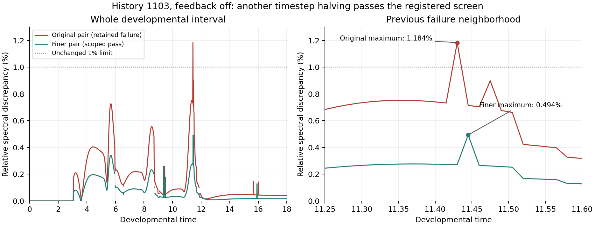

# History-1103 timestep refinement: completed assessment

The independent saved-array review **accepts the registered finer timestep pair** for history 1103, feedback off, grid 120³, t=0–18. Maximum dense spectral discrepancy is **0.4936%**, below the unchanged **1%** limit. Reconstructed density-field discrepancy is **0.1007%**. Every inherited gate passes. This is scoped numerical acceptance of an existing history, not completion or retrospective acceptance of the original three-history pilot.

[Frozen diagnostic design](fresh_zygote_time_refinement.md), [machine-readable assessment](fresh_zygote_time_refinement_assessment.json), [independent review](../archive/study-reviews/2026-10-12-fresh-zygote-time-refinement/independent_review.json), [review log](../archive/study-reviews/2026-10-12-fresh-zygote-time-refinement/review.log). The new protocol is `54632a1f284affcbcec93cd0f1036d2d9c3788bd93ef5480df5fa1f14336c6c3`. Original production records remain unmodified, including their provisional/pending-review fields; this separate report records the independent decision.

## Design and completion

One new trajectory repeated history 1103 from its original analytic zygote at **dt=0.0001171875** (153,600 steps). The saved **dt=0.000234375** trajectory is reused read-only. Only timestep and integer clocks differ; geometry, chemistry, polarity, numerical corrections, lineage, cell-cycle schedule and random streams match at t=0. The conservative transport, contact cutoff 0.02, solver/kernel binary, model and limits are unchanged.

The coordinator finished **11 October 2026 at 21:10 America/New_York**, after **76.5 minutes**. Both paths reach t=18 with sixteen cells, fifteen abscissions, no active furrows and at least three mature units. Zero new independent histories are added. Branches, cells and timestep repeats remain nested within history 1103.

## Numerical evidence

| Comparison | Maximum | Limit | Decision |
| --- | ---: | ---: | --- |
| Reconstructed density fields | 0.1007% | 1% | Pass |
| Regular transport spectra | 0.3400% | 1% | Pass |
| Dense equal-count transport spectra | 0.4936% | 1% | Pass |
| Log chemical distribution distance | 0.0004143862 | 0.01 | Pass |
| Chemical contrast difference | 0.00101091 | 0.005 | Pass |
| Shape-axis discrepancy | 0.0457% | 1% | Pass |
| Total-volume discrepancy | 0.0059% | 0.5% | Pass |
| Total-species-amount discrepancy | 0.0007% | 0.5% | Pass |
| Mean-polarity discrepancy | 3.218435e-06 | 0.01 | Pass |
| Maturity-time discrepancy | 0.001289062 | 0.05 | Pass |

The dense maximum occurs at **t=11.445**, with eight cells and **18 versus 19 edges**. Regular histories have one unequal-count observation at t=8.7; dense records have four at t=5.955, 8.7, 8.745 and 11.925. These remain recorded and excluded only from equal-dimension spectral comparisons. Edge-support mismatches at t=9.39, 9.495, 11.445 and 15.915 are retained.

The new path's maximum volume error is **1.7112%**, minimum effective radius **8.4995 voxels**, dilution amount error at most **4.44e-16**, and clipping zero. All event, boundary/connectivity and conservative graph checks pass. The exact eight-step live-cleavage restarts at 2→4, 4→8 and 8→16 and the independent actual-start prefix pass their recorded gates.

The independent NumPy/SciPy review imports no embryo solver or production comparison. It verifies **43 source and 405 input hashes**, both paths' events/lineage, regular histories, all dense graph and pressure records, all fourteen regular checkpoint arrays and all six saved live-cleavage states. It independently recomputes distribution/shape/volume/amount/polarity comparisons, graph spectra and all seven paired density-field reconstructions. Actual-start and eight-step restart results are verified from saved evidence; no new GPU stepping, full fine CPU ladder or full remaining-horizon replay is performed.

## What changed at the earlier failure

At **t=11.43**, the original dt=0.00046875/0.000234375 pair remains a **1.1836% failure**, with fifteen versus seventeen contact edges. The new dt=0.000234375/0.0001171875 pair has **seventeen edges in both paths** and **0.2715%** spectral discrepancy at that same time.

The new maximum at t=11.445 still includes a contact-cutoff switch: cells 10 and 13 have overlap-minus-cutoff margins −7.55e-8 and +2.56e-7, giving zero versus 0.0082056 conductance. Refinement reduces the measured discrepancy sufficiently to pass the screen; it does **not** remove the hard-cutoff discontinuity or demonstrate a convergence order, uniform accuracy across histories, general geometric closure, or full coupled-system stability. Peak times differ between the two comparisons, so their ratio is not an error-order estimate.

Both original dense traces match their preceding independent-review hashes. The original failed pilot/status/comparison and its six unexecuted controls remain unchanged; no failed point, seed, threshold or mechanism has been replaced.

## Scientific scope of the short endpoint

| Timestep | SD of log activator at t=18 | Aggregate axis ratio | Frozen uniform unstable modes |
| --- | ---: | ---: | ---: |
| 0.000234375 | 0.00309181 | 1.28524863 | 9 |
| 0.0001171875 | 0.00309337 | 1.28516680 | 9 |

Chemistry is still near uniform. The closely agreeing endpoint measurements are consistent with numerical reproducibility of this short feedback-off development. They establish neither sustained chemical organization nor emergent biological identities. Shape anisotropy occurs without regulatory mechanical feedback; it is not evidence for chemically driven shape symmetry breaking. The nine frozen unstable modes concern local linear chemistry on a fixed endpoint, not the evolving coupled system or eventual nonlinear formation.

## Next test

Register a **separate history-1103 matched-control completion study** with tension/adhesion, polarity and full coupling, each at **dt=0.000234375 and 0.0001171875** through t=18 on grid 120³: **six new numerical paths**, zero new independent histories. Reuse the accepted feedback-off paths only for their declared comparison/control role. Preserve the original pilot's unexecuted design rather than resuming or overwriting it, and retain exact initial-state matching, correction-aware restarts and every physical/temporal limit.

After the matched developmental controls pass their independent review, qualify efficient mature timesteps on actual endpoints before the declared long formation/maintenance windows. No new simulation is launched by this review. Ledger and manuscript scientific claims are unchanged.
