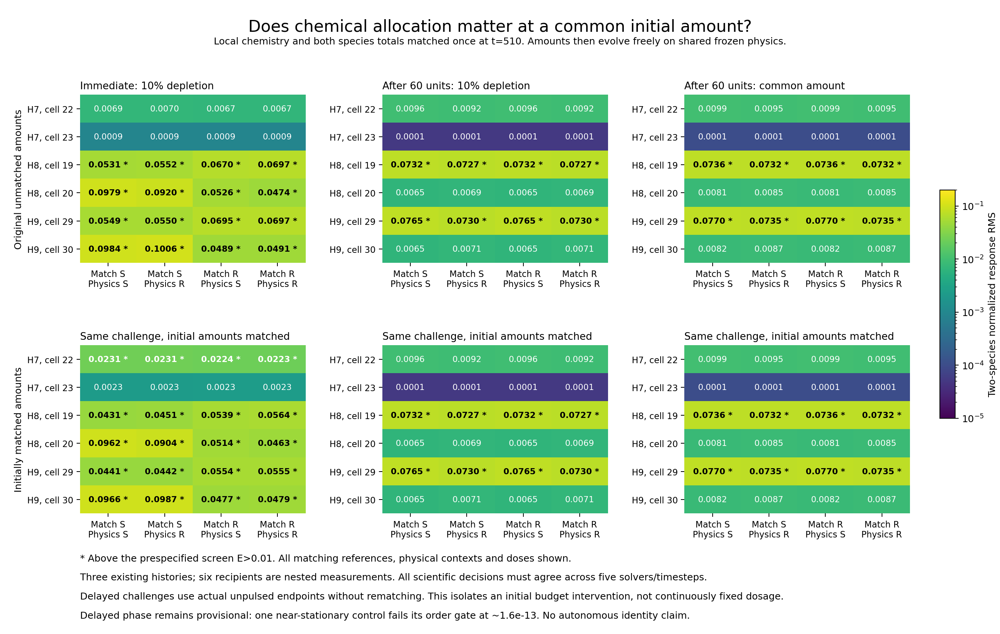
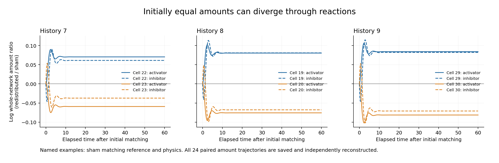

# Initial surrounding-amount matching: two-phase assessment

**The immediate phase is accepted. The delayed phase is complete but remains unaccepted because one control fails the declared convergence-order criterion.** Its other numerical gates pass. The separate array review reproduces the failure and all scientific measurements; no acceptance limit is changed.

Both phases reuse three existing mature developmental histories (7–9), with two selected recipients nested within each. They add zero developmental histories. At t=510, recipient activator/inhibitor concentrations, physical context and both species’ surrounding/whole-network amounts match. Non-target species allocation fractions remain distinct. Their common initial budget is the symmetric geometric mean. Species-specific rescaling can change non-target activator/inhibitor ratios; it is a specified normalization, not a biological law.

## What the completed calculations show

The [accepted immediate phase](phase_carry_recipient_amount_response_assessment.md) detects effects above the primary screen in **1/2, 2/2 and 2/2 recipients** across histories 7–9 under both matching references and both physical contexts. Cells 22, 19, 20, 29 and 30 are above screen; cell 23 is below. Initial amount matching therefore does not eliminate the tested surrounding-allocation sensitivity. All 48 immediate pulses recover toward their own controls.

After the fixed 60-unit wait, the **provisional delayed counts are 0/2, 1/2 and 1/2** at both doses, matching references and shared physical contexts. Only cells 19/29 exceed the screen. Cell 22’s enlarged immediate response, and the large immediate responses of cells 20/30, do not persist as above-screen delayed responses. All 96 delayed logical pulse labels recover. These observations agree across three timesteps and both independent reference solvers, while formal full-study acceptance remains blocked by the control-order failure.

| History | Cell | Accepted immediate RMS range | Provisional delayed RMS range | Delayed primary screen |
|---|---|---|---|---|
| 7 | 22 | 0.022332–0.023113 | 0.009242–0.009869 | Below |
| 7 | 23 | 0.002327–0.002343 | 0.000051–0.000106 | Below |
| 8 | 19 | 0.043114–0.056425 | 0.072728–0.073646 | Above |
| 8 | 20 | 0.046275–0.096219 | 0.006493–0.008493 | Below |
| 9 | 29 | 0.044119–0.055480 | 0.073021–0.076991 | Above |
| 9 | 30 | 0.047677–0.098746 | 0.006543–0.008702 | Below |

The strict operational screen is E>0.01, using 60-unit time RMS of the difference in signed, two-species target pulse/own-control log responses, normalized by each pulse’s actual initial log amplitude. Ranges span both references and physical contexts, and both doses for the delayed phase. Below-screen is not equivalence; physical contrasts and interactions remain descriptive.

All 48 delayed classifications agree with the accepted unmatched-budget assay. The maximum absolute fine-RMS difference is 9.69e-13. A post-run descriptive endpoint comparison finds maximum raw log discrepancy 2.56e-13 between the new unpulsed endpoints and corresponding unmatched-budget endpoints. That comparison introduces no new acceptance threshold and does not prove identical basins or global stability.

Initial equality is not a continuing clamp. Reactions subsequently change amounts freely. All 24 paired whole-network and surrounding amount curves are saved and separately reconstructed in each phase. The largest initial paired relative discrepancy is 5.55e-16. Across preparations, final whole-network R/S ratios span 0.9205–1.0878 for activator and 0.9291–1.0857 for inhibitor. Later inequalities are outcomes; this is sensitivity to initial allocation at a common initial budget, not dosage independence throughout the trajectory.

All 48 delayed sources are actual unpulsed fine endpoints without rematching. Every source passes the 1e-8 qualification gate and descriptive settling screens. Maximum preceding 24-unit raw log drift is 2.81e-10; maximum absolute instantaneous log rate is 5.72e-14. These screens do not establish mathematically exact equilibrium.

## The unresolved numerical check

The failed case is history 9, cell 30, original sham recipient reference, sham physics, redistributed chemistry, **unpulsed control**. Its maximum raw log errors against the independent solvers are:

| Timestep | Error |
|---|---|
| 0.00375 | 2.57572e-14 |
| 0.001875 | 1.56097e-13 |
| 0.0009375 | 1.56097e-13 |

The solvers disagree by 1.55431e-15. The finest error exceeds the declared 100× reference-noise floor, so the unchanged rule marks order as resolved. It then measures orders -2.5994 and 0.0, failing the required 1.7–2.3 interval. We retain this failure even though the absolute errors are tiny.

The [higher-precision diagnosis](../archive/study-reviews/2026-10-08-recipient-amount-delayed-response/roundoff-diagnostic.json) confirms float64 stagnation. Fine and diagnostic saved controls remain exactly equal to their starting arrays; coarse controls move. The same SSP-RK2 equations in longdouble resolve a roughly 1.57e-13 relaxation, with positive states throughout. An independently computed 80-digit stationary solution has residual 9.487e-81. The source lies about 1.22e-13 away in maximum log concentration. Both independent solver endpoints lie about 1e-15 from that solution. The smaller float64 updates cannot represent the remaining relaxation; the order screen has encountered an arithmetic floor. No source is projected onto equilibrium, no trajectory is replaced, and no criterion is amended.

## Numerical coverage and next action

| Evidence | Immediate | Delayed |
|---|---|---|
| Logical starts | 96 | 144 |
| Distinct problems within labels | 96 | 120 |
| Physically distinct problems ignoring labels | 96 | 118 |
| GPU paths | 288 | 432 |
| CPU verification paths | 288 | 432 |
| Independent reference trajectories | 192 | 288 |
| Order gate passes | 96/96 | 143/144 |
| Raw CPU/GPU maximum log error | 3.03e-13 | 2.45e-13 |
| Coordinator time, minutes | 4.74 | 6.18 |

All 144 delayed dual-reference cases, 432 production/CPU accuracy rows, 288 raw timestep comparisons, 864 response-comparison rows and 1,080 signed-contrast rows pass. Of the 144 order cases, 96 pulses and one control meet the rule for resolved order; the failing case is that control. The remaining 47 control orders stay unresolved, without assigning order two. Eight CPU workers verify GPU production; repeated dose labels and padding add no independent evidence. The combined experiment calculated 720 GPU paths, 720 CPU verification paths and 480 reference solves.

The next numerical task is to validate **compensated chemical accumulation** in an isolated solver branch against the stationary precision diagnosis and nonstationary dual-solver references, including positivity and conservative exchange. Then repeat the delayed assay as a new pinned study under the existing gates. Preserve this failed run; do not relax its thresholds or edit shared historical kernels. Moving-geometry confirmation follows numerical qualification and is not launched here.

These tests support conditional chemical-state/response differences, not autonomous or inherited biological identities, nearest-neighbor specificity, or fresh differentiation from a zygote. Frozen geometry, sixteen-cell resolution, three selected histories, historical developmental inheritance and geometric conductance limitations remain. The accepted parents, results ledger and manuscript are unchanged.

[Protocol](phase_carry_recipient_amount_response.md), [machine-readable assessment](phase_carry_recipient_amount_delayed_response_assessment.json), [separate full array review](../archive/study-reviews/2026-10-08-recipient-amount-delayed-response/independent_review.json), [72 comparison rows](../archive/study-reviews/2026-10-08-recipient-amount-delayed-response/comparison-summary.csv).

