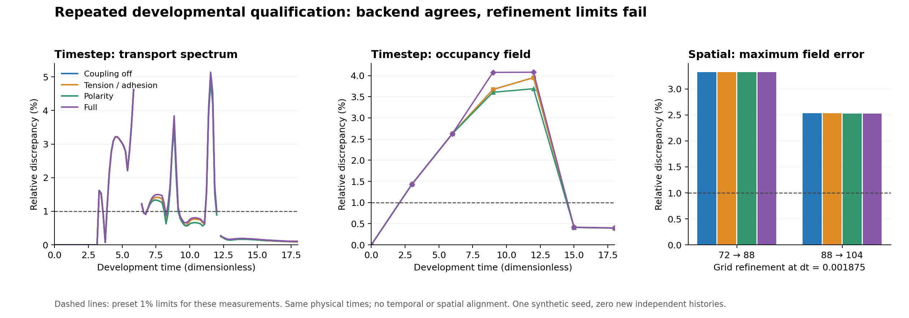

# Repeated developmental GPU qualification: completed assessment

**The study is complete, but repeated development is not numerically qualified.** All twenty trajectories finish fifteen resolved divisions, reach sixteen cells at t=18 and pass their recorded physical/event checks. All four coarse CPU/GPU comparisons pass. All four timestep comparisons and all eight spatial comparisons fail unchanged limits. The [independent saved-data review](../archive/study-reviews/2026-10-10-repeated-development-gpu/independent_review.json) confirms these failures; the original study remains `completed_with_unresolved_checks`.

The GPU reproduces the NumPy calculation at the same grid and timestep. The shared calculation still has excessive sensitivity to timestep and grid during cleavage. Fresh independent histories remain gated on developmental accuracy.

## Design and review scope

The [prospective protocol](repeated_development_gpu.md) defines four controls: coupling off; activity-dependent tension/adhesion; polarity-dependent tension; and their full combination. Each starts from the same analytically sampled zygote, initial chemistry and random streams, with naturally scheduled, shape-selected cleavage. Grids are 72/88/104 cubed; timesteps are 0.00375/0.001875. Sixteen GPU paths and four complete parallel NumPy references follow through t=18. The total production/assessment runtime was **109.58 minutes**. These repetitions of one synthetic seed add **zero new independent scientific histories**.

The separate review imports no embryo solver or production comparison helper. It checks 2,420 saved observation rows, independently recomputes conservative graph spectra through a generalized symmetric eigenproblem and chemical-distribution distances through weighted empirical distributions, and checks all 140 regular checkpoints and 48 mixed-count restart samples. It reconstructs all 56 native-field CPU/GPU and timestep comparisons. For each of eight spatial pairs it independently reconstructs a failing primary-field witness. All 24 source pins, 18 input pins, recorded result/evidence hashes, the runtime binary and **1,289 preserved evidence pins** verify.

Full spatial checkpoint/endpoint-variant reanalysis and independent full-horizon restart replay were not performed. Spatial trend/spread extrema below retain their production provenance. The independently reproduced failures already preclude acceptance. Every-step extrema and short bitwise restart tests are recorded runtime evidence; saved-array checks sample the corresponding states. [Review script](../archive/study-reviews/2026-10-10-repeated-development-gpu/review_saved_arrays.py), [review log](../archive/study-reviews/2026-10-10-repeated-development-gpu/review.log), [machine-readable assessment](repeated_development_gpu_assessment.json).

## What passes

All twenty paths finish fifteen divisions with positive chemistry, resolved daughter connectivity and conservation within the preset event limits. Recorded maximum cell-volume error is **1.6173%** against a 5% limit; the smallest equivalent cell radius is **5.0988 grid spacings** against a four-spacing minimum. Mechanical clipping is zero. Maximum observed boundary occupancy is **7.78e-12**, below 0.01. The independently checked transport operators preserve constants and cell-volume-weighted amounts and have weighted symmetry.

All four coarse CPU/GPU comparisons pass aggregate and corresponding-cell checks, with matching parent trees, partition draws, event times and final random states. Maximum corresponding-cell chemical log discrepancy is **2.66e-9**, maximum visible-phase discrepancy **5.96e-8**, and maximum relative transport-spectrum discrepancy **9.87e-7** against its 1e-5 limit. Native density-field discrepancies are at most **1.63e-8**. This supports same-discretization backend agreement at the tested configurations.

All sixteen GPU paths record eight exact restored/uninterrupted steps at each of three live-furrow, mixed-count windows. Independent inspection confirms the stored numerical corrections, active-event states and checkpoint schemas. Independent full replay remains a separate acceptance requirement.

## Temporal accuracy fails during cleavage

At grid 72, compare dt=0.00375 against 0.001875 at unchanged physical times. The spatial-field and spectrum limits are both **1%**.

| Mechanical control | Maximum occupancy-field discrepancy | Maximum spectrum discrepancy | Result |
|---|---:|---:|---|
| Coupling off | 3.9510% | 5.0340% | Fail |
| Tension/adhesion | 3.9513% | 5.0330% | Fail |
| Polarity | 3.6890% | 4.8557% | Fail |
| Full | 4.0785% | 5.1366% | Fail |

Activator/inhibitor density fields also fail; polarity-density errors pass. Chemical distributions, contrast, whole species amounts, total volume, mean polarity, tissue-axis ratio, cell-count differences and maturity timing pass their respective timestep limits. Their agreement does not establish spatial or transport accuracy.

Each spectrum peak occurs at t=11.55, with eight cells and sixteen contact edges in both paths. Each occupancy-field peak occurs at t=12 during the eight-to-sixteen-cell transition. Endpoint occupancy errors fall to **0.3956–0.4013%**, below the field limit, while earlier failures remain. Last-abscission differences are 0.02625–0.03 time units, within their separate 0.05 limit. Matching parent spindle axes differ by less than 0.096 degrees; parent-tree and partition-draw correspondence are verified for these diagnostics. These are descriptive clues; they do not isolate a cause. [Per-parent clock/axis diagnosis](../archive/study-reviews/2026-10-10-repeated-development-gpu/cleavage-clock-diagnosis.json).

## Spatial accuracy improves but remains unresolved

At fixed dt=0.001875, spatial fields have a **1%** limit and the transport spectrum a **5%** limit. Production maxima below are independently reproduced at their recorded primary-field peaks.

| Mechanical control | Grid pair | Maximum spatial-field discrepancy | Maximum spectrum discrepancy | Result |
|---|---|---:|---:|---|
| Coupling off | 72 → 88 | 3.3221% | 11.4028% | Fail |
| Coupling off | 88 → 104 | 2.5306% | 4.3578% | Fail |
| Tension/adhesion | 72 → 88 | 3.3219% | 11.4000% | Fail |
| Tension/adhesion | 88 → 104 | 2.5308% | 4.3574% | Fail |
| Polarity | 72 → 88 | 3.3213% | 11.4101% | Fail |
| Polarity | 88 → 104 | 2.5237% | 4.0590% | Fail |
| Full | 72 → 88 | 3.3211% | 11.4074% | Fail |
| Full | 88 → 104 | 2.5238% | 4.0582% | Fail |

The 72→88 field peaks occur at t=6; 88→104 peaks at t=9. All four production trend screens improve with refinement, and finest-pair spectra pass their limit. Finest-pair transient fields still fail, even though their endpoint field discrepancies are about 0.81–0.83%. Endpoint reconstruction-order/probe spreads are small in the production reports. Analytical reconstruction calibration had passed before launch. Neither calibration nor decreasing discrepancies establish full developmental accuracy; the fixed spatial-study timestep also remains temporally unqualified.

## Interpretation and next test

The similar failures across all four branches, including coupling off, support investigating a shared numerical sensitivity during repeated cleavage. They do not establish a polarity-specific mechanism. Small spindle-axis differences and accumulating event-clock differences make furrow deformation, volume projection, thresholded abscission and propagation through descendant cell cycles plausible targets. Contact conductances and cutoffs may amplify shape differences. These are hypotheses for the next numerical experiment.

Prioritize a prospectively specified **feedback-off timestep ladder** at grid 72, adding dt=0.0009375 and 0.00046875 to the preserved pair. Record per-furrow progression, neck values, volume-projection corrections, event clocks, occupancy fields and contact conductances around each transition. Keep physical times and existing limits unchanged; do not align trajectories or relax failed gates. Determine whether errors decrease with refinement and locate their first divergence. If refinement stalls, isolate the implicated update before modifying it.

Once temporal accuracy is demonstrated, repeat spatial qualification at a qualified timestep. Only then launch the independently seeded fresh-zygote pilot. This study supplies a numerical diagnosis and no new cell-identity, initiation or inheritance result.

[Original production summary](../output/studies/repeated-development-gpu-qualification-v2/summary.json), [original status](../output/studies/repeated-development-gpu-qualification-v2/status.json), [historical launch/interim record](repeated_development_gpu_launch.md).
