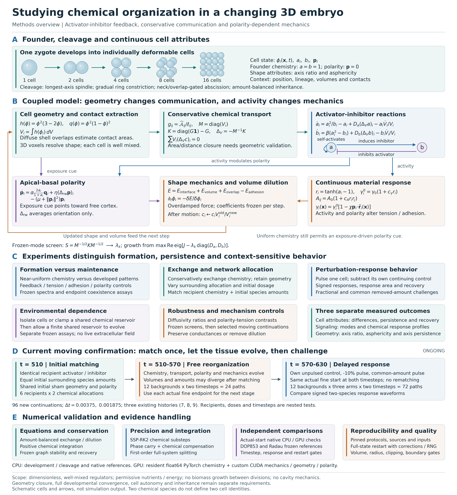

# Methods diagram: chemical organization in a changing 3D embryo



[Editable vector figure](images/study-methods-overview.svg) | [Print-ready PDF](../output/pdf/study-methods-overview.pdf) | [Reproducible generator](figures/study_methods_overview.py) | [Source and export hashes](images/study-methods-overview.json)

## Figure caption

**Methods for testing initiation, maintenance and network-supported chemical behavior.** The diagram links a generic developmental model to the interventions used to challenge its explanations. Cells and arrows are schematic, not measured simulation output; colors identify mechanisms rather than cell types. All quantities use uncalibrated model units.

**A. Development and representation.** A smooth spherical zygote begins with equal unit activator and inhibitor activity and zero polarity. Every cell has a three-dimensional diffuse shape field, two well-mixed regulators and an apical-basal polarity vector. The CPU developmental model uses a spindle along the longest cell axis, progressive contractile-ring forcing and abscission gated by neck and prospective-overlap measurements. Daughter inheritance preserves regulator amounts and records lineage. Cycle timing and ring forcing are supplied rules; the chemical loop does not derive the cell cycle. Cleavage partitions existing target volume, with no biomass growth between divisions. The sixteen-cell cap is an experimental choice, not an emergent cell count. [Developmental methods](attribute_development.md), [cytokinesis](cytokinesis.md).

**B. Coupled physical and chemical model.** Geometry determines measured volumes, approximate contact areas and exposure cues. The occupancy function counts volume smoothly; the quartic potential favors the inside and outside phases while the gradient penalty supports a diffuse interface. Contact conductances and measured capacities define conservative chemical exchange. Activator self-production induces inhibitor production, and inhibitor suppresses activator production. Cell activity changes material coefficients continuously; polarity makes tension directional. These forces change cell shape and volume, which alters subsequent exchange and causes dilution or concentration. Material response is instantaneous, not a separately stored identity or memory variable. The normalized neighbor operator is retained only for orientation averaging, never for molecular transport. [Annotated equations](model.md), [conservative transport](live_transport.md), [polarity](graph_signaling.md#apicalbasal-polarity-and-mechanics).

The energy shorthand defines the attraction magnitude as a positive term:

$$
E=E_{\mathrm{interface}}+E_{\mathrm{volume}}+E_{\mathrm{overlap}}-E_{\mathrm{adhesion}}.
$$

Here interface cost is the integral of the gradient and double-well terms; the volume term penalizes departures from target volume; the overlap term discourages interpenetration; and subtracting the adhesion magnitude rewards diffuse-interface contact. Mechanical coefficients are frozen when evaluating the variational force. This is overdamped shape relaxation, with additional division forcing during development, not a fluid momentum solver or a globally passive system.

For the chemical growth screen, volumes and contacts are fixed and the local reaction Jacobian at unit chemistry is

$$
J=\begin{pmatrix}1&-1\\2\beta&-\beta\end{pmatrix}.
$$

The symmetric capacity-weighted operator supplies spatial eigenvalues. Each mode is tested using the largest real part of the eigenvalues of $J-\lambda_k\operatorname{diag}(D_a,D_b)$. This predicts early small-perturbation growth on that frozen graph, not nonlinear persistence or stability of the moving system.

**C. Experimental comparisons and outcomes.** Near-uniform and developed starts separate formation from maintenance. Mechanical component controls separate tension, adhesion and polarity effects. Chemical exchange leaves cell position, shape and lineage in place; it is not physical cell relocation. Network-allocation and dosage comparisons distinguish initial spatial distribution from initial bulk amounts. Environmental assays test isolation, externally clamped reservoirs and a finite evolving shared reservoir; these are separate frozen compartment assays, not a spatial extracellular field in the live embryo. Pulse trajectories are compared with their own continuing unpulsed controls. Dispersion, persistence, signed response, response area, recovery, shape and spatial modes are measured separately. Frozen endpoint coexistence means tested local chemical basins, not proof of global attractor stability. [Assay framework](attribute_development.md#how-the-identity-assays-build-on-development), [reservoir methods](attribute_finite_reservoir.md).

**D. Current moving confirmation, ongoing when drawn.** Six selected recipients are nested in three existing developmental histories. Each recipient has two surrounding chemical allocations with its initial activator/inhibitor pair and each species' initial surrounding amount matched on shared sham physics. Twelve backgrounds are evolved through a sixty-unit wait at two timesteps. Each actual new fine endpoint supplies a matched control, a minus-ten-percent activator pulse and a common removed-amount pulse at both timesteps. The common dose removes ten percent of the smaller actual recipient activator amount across its paired backgrounds, using actual volumes. There is no second matching intervention at the delayed challenge; later volumes, amounts and geometry may differ. The study has 96 new moving continuations but only three developmental histories. Neither this schematic nor a completed numerical coordinator constitutes scientific acceptance. [Prospective protocol](moving_recipient_amount_response.md).

**E. Computation and validation.** CPU development retains cleavage; native C++/OpenMP supplies mature-state physical references. Resident PyTorch tensors and matrix operations are combined with custom CUDA mechanics, geometry and polarity for validated mature continuations. Visible phase fields remain float32 with float64 phase-update carry. The latest isolated branch retains float64 chemical rounding corrections through chemical steps, dilution and checkpoints; these corrections are numerical bookkeeping, not biological memory. Chemistry uses positivity-restricted SSP-RK2 substeps, while the complete moving coupling remains first-order splitting. Actual-start CPU/GPU comparisons, independent frozen DOP853/Radau references, timestep comparisons, interruption/restart tests and physical-quality gates address different numerical questions. Source/input hashes and preserved checkpoints make interventions and failures auditable. Passing backend comparisons does not resolve general geometric transport closure or full developmental convergence. [Backend methods](model.md#resident-gpu-backend-validation), [chemical compensation](compensated_chemistry.md), [moving arithmetic](moving_recipient_amount_response.md#arithmetic-and-checkpoints).

## Symbol key and current moving-assay settings

These values describe panel D. Other experiments deliberately change parameters or use historical methods; their settings must be reported separately.

| Symbol | Meaning | Current moving assay |
|---|---|---|
| $a_i,b_i$ | Reduced activator and inhibitor activities, not named genes or cell types | Positive continuous variables |
| $\phi_i$ | Spatial cell indicator; near one inside and zero outside | $72^3$ voxel grid; box half-width 2.24 |
| $\epsilon$ | Diffuse-interface length scale, distinct from voxel spacing | 0.085 |
| $V_i,V_i^\star$ | Measured and preferred cell volumes | Measured volumes evolve; target volumes are supplied |
| $\widehat{\mathcal A}_{ij},\ell_{ij},g_{ij}$ | Approximate contact area, center separation and area/distance conductance | Flat-interface shell-overlap calibration; geometric limitations remain |
| $M,K,\Delta_V$ | Capacity matrix, conductance Laplacian and concentration exchange operator | Volume-weighted conservative transport |
| $D_a,D_b$ | Activator and inhibitor diffusivities | 0.02 and 0.55; ratio 27.5 |
| $\beta$ | Inhibitor production/turnover rate relative to activator dynamics | 2 |
| $\mathbf p_i,\mathbf q_i$ | Apical-basal polarity and vector cue from asymmetric free-surface exposure | Polarity direction and magnitude evolve |
| $\alpha,\eta,\mu$ | Polarity production, orientation alignment and linear decay rates | 1, 0.25 and 0.5 |
| $\gamma_0,K_V,R,A_0$ | Baseline interface, volume-restoring, overlap and adhesion coefficients | 1, 12, 3 and 4 |
| $c_\gamma,c_A,\chi$ | Activity-dependent tension, adhesion and directional polarity contrast | 0.25, 0.35 and 0.35 |
| $\Delta t$ | Full moving-system timestep | 0.00375 and 0.001875 |

The scalar potential $q(\phi)$ and vector exposure cue $\mathbf q_i$ have different roles. Adhesion coefficient $A_{ij}$ is distinct from geometric contact area $\mathcal A_{ij}$. Reactions create and consume regulator amounts; conservation checks apply to exchange, geometric dilution and conservative interventions, not to the complete reacting system.

Nutrients, oxygen and energy are assumed permissive. Metabolism, biomass growth and pressurized cavity formation are absent. A maintained chemical profile is a candidate attribute pattern; biological cell identity also requires reproducible behavior, appropriate context tests and, for an inheritance claim, subsequent division evidence. No prescribed type count or identity classifier appears in this diagram.

## Regenerate the exports

```bash
OPENBLAS_NUM_THREADS=1 OMP_NUM_THREADS=1 \
/home/sji/miniforge3/envs/deeplearning/bin/python docs/figures/study_methods_overview.py
```

The generator performs a text-bounds check and records source/export hashes. It uses CPU plotting only and does not read, write or restart scientific trajectories. The PDF is visually checked after rendering with Poppler.
